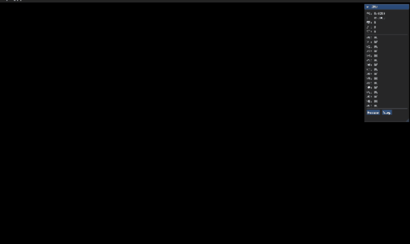

# CHIP-8 Emulator

A CHIP-8 emulator written from scratch in C++17, with SDL2 for graphics, input, and sound, and Dear ImGui for the menus and a live CPU debugger.



## Features

- **Full CHIP-8 instruction set**: all 35 opcodes, implemented as a fetch-decode-execute loop
- **Verified with test ROMs**: passes the [Timendus CHIP-8 test suite](https://github.com/Timendus/chip8-test-suite) opcode test (corax+) and flags test
- **Graphics**: 64x32 display, scaled to fit any window size; resizable and fullscreen-friendly
- **Input**: 16-key hex keypad mapped onto a modern keyboard
- **Sound**: 440 Hz square-wave beep driven by the sound timer
- **Timers**: delay and sound timers tick at 60 Hz, independent of CPU speed (~600 instructions/sec)
- **ROM loading**: pick a game from the ROMs menu, drag a `.ch8` file onto the window, or pass one on the command line
- **Debugger**: live view of PC, I, SP, timers, and V0–VF, with pause and single-step

<!-- Optional: add a screenshot of the CPU debug window here -->

## Controls

The original CHIP-8 had a 4x4 hex keypad. It's mapped onto the left side of the keyboard:

```
CHIP-8 keypad      Keyboard
1  2  3  C         1  2  3  4
4  5  6  D    →    Q  W  E  R
7  8  9  E         A  S  D  F
A  0  B  F         Z  X  C  V
```

| Game | Controls |
|---|---|
| Pong | Left paddle: `1` / `Q` — Right paddle: `4` / `R` |
| Tetris | Rotate: `Q` — Left/right: `W` / `E` — Drop: `1` |

## Building

Developed on Windows with MSYS2 (UCRT64), CMake, and Ninja.

**1. Install the toolchain** (in the *MSYS2 UCRT64* terminal):
```
pacman -S --needed mingw-w64-ucrt-x86_64-gcc mingw-w64-ucrt-x86_64-cmake mingw-w64-ucrt-x86_64-ninja mingw-w64-ucrt-x86_64-SDL2
```

**2. Clone with submodules** (Dear ImGui is included as a Git submodule):
```
git clone --recursive https://github.com/nataliaprobber/chip8-emulator.git
cd chip8-emulator
```
If you already cloned without `--recursive`, run `git submodule update --init`.

**3. Build:**
```
cmake -S . -B build -G Ninja
cmake --build build
```

## Running

ROMs are not included in this repository. Put `.ch8` files in a `roms/` folder next to the project (it's created automatically on first run). Free, public-domain CHIP-8 games are available from collections such as [kripod/chip8-roms](https://github.com/kripod/chip8-roms).

```
.\build\chip8.exe                  # start empty, pick a game from the ROMs menu
.\build\chip8.exe roms\pong.ch8    # start a specific ROM
```

## How it works

The emulator is split into two parts that meet at a few clean points:

- **`src/chip8.h`: the machine.** Memory (4 KB), 16 registers, the index register, program counter, stack, timers, display buffer, and keypad state. `cycle()` runs one instruction: it fetches two bytes at `pc`, decodes them into fields (`x`, `y`, `n`, `kk`, `nnn`) with bit masks and shifts, then executes through a `switch` on the opcode's first digit. It has no dependency on SDL.
- **`src/main.cpp`: the outside world.** Each frame: handle input events, run 10 CPU cycles, tick the timers once, queue audio if the sound timer is active, build the ImGui menus and debugger, then draw the display buffer scaled to the window.

Implementation notes:
- `8XY4`–`8XYE` compute the result before writing `VF`, so the flag is correct even when `X` is `F`
- Sprites are XOR-drawn with collision detection; the starting position wraps, and pixels past the edge are clipped
- `FX0A` waits for a key by re-running itself (`pc -= 2`) instead of blocking, so input and rendering keep running
- Behaves like modern CHIP-8 interpreters: shifts operate on `VX`, and `FX55`/`FX65` leave `I` unchanged

## Credits

- [Cowgod's Chip-8 Technical Reference](http://devernay.free.fr/hacks/chip8/C8TECH10.HTM) and [Tobias V. Langhoff's guide](https://tobiasvl.github.io/blog/write-a-chip-8-emulator/): CHIP-8 specification
- [Timendus CHIP-8 test suite](https://github.com/Timendus/chip8-test-suite): test ROMs
- [SDL2](https://www.libsdl.org/): window, input, audio
- [Dear ImGui](https://github.com/ocornut/imgui): menus and debugger UI